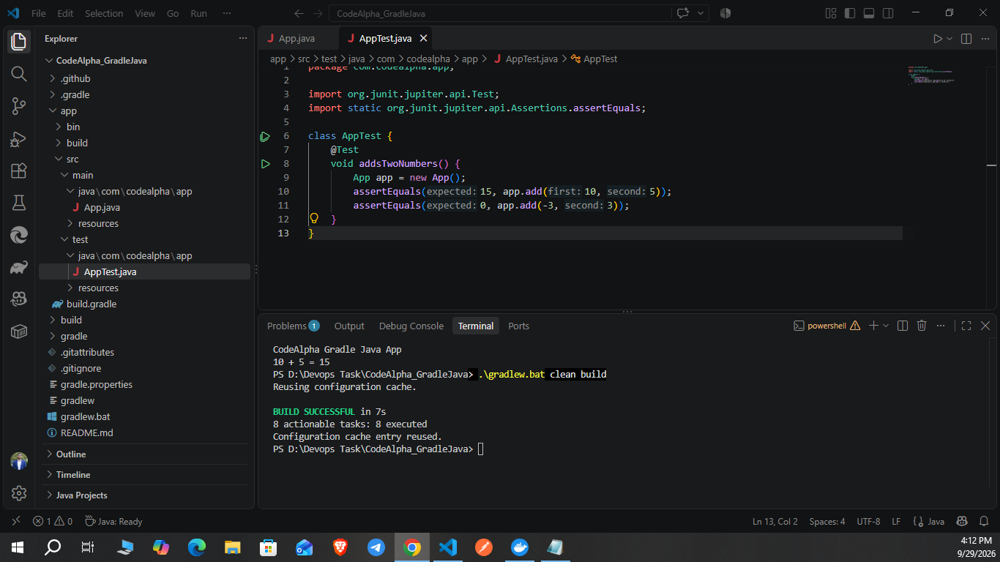
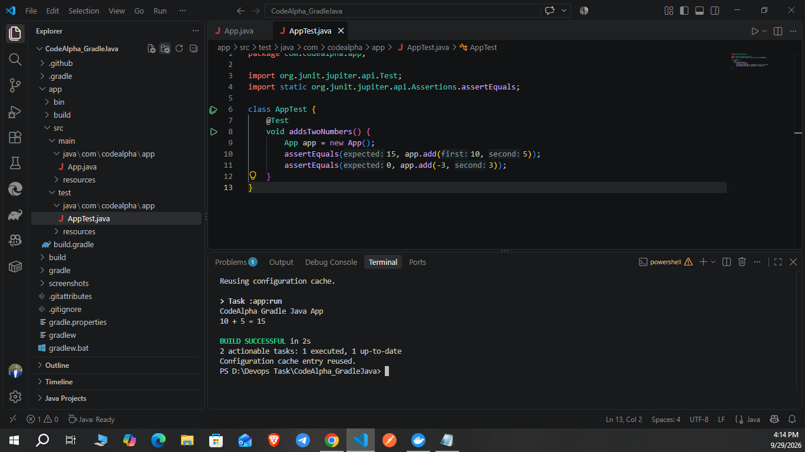

# CodeAlpha DevOps — October 2026 Task Submission

**Author:** [Dayan Ganganath](https://github.com/dayanganganath)  
**Completed projects:** Jenkins Remoting, Gradle Java Application, and Docker Web Server.

This repository collects all three completed tasks, including source files, individual README guides, and screenshots of successful local execution.

## Completed tasks

| Task | Project and documentation | Demonstrated work |
|---|---|---|
| Task 2 | [Jenkins Remoting](Task02_JenkinsRemoting/README.md) | Docker controller and agent, WebSocket connection, label-based Groovy pipeline, archived artifact, successful execution |
| Task 3 | [Gradle Java Application](Task03_GradleJava/README.md) | Java 17 application, Gradle Wrapper, Groovy build configuration, JUnit test, successful build and run |
| Task 4 | [Docker Web Server](Task04_DockerWebServer/README.md) | HTML/CSS page, Nginx image, Dockerfile, port mapping, container inspection and management |

## Get started

```powershell
git clone https://github.com/dayanganganath/codealpha_tasks.git
cd codealpha_tasks
```

Run project-specific commands from the matching task directory:

```powershell
cd Task03_GradleJava
.\gradlew.bat clean build
.\gradlew.bat run
```

For Docker, work in `Task04_DockerWebServer` and follow its image build/run commands. For Jenkins, follow `Task02_JenkinsRemoting/README.md` to set up the controller, agent, and pipeline.

Each individual README also links to its original standalone repository. In this combined checkout, use the task folders above in place of cloning those standalone copies.

## Evidence

### Jenkins Remoting


### Gradle Java Application




### Docker Web Server


## Languages, tools, and skills

- **Languages and configuration:** Java, Groovy, HTML, CSS, Dockerfile, TOML, PowerShell commands, and Linux shell commands.
- **Tools:** Jenkins, Jenkins Remoting, Docker, Nginx, Gradle Wrapper, JUnit Jupiter, Git, and GitHub.
- **Practical skills:** container builds and lifecycle management, port mapping, Docker networking, persistent controller storage, distributed pipeline execution, Java build automation, unit testing, dependency management, artifact archiving, and technical documentation.

## Original project repositories

- [Docker Web Server](https://github.com/dayanganganath/CodeAlpha_DockerWebServer)
- [Gradle Java Application](https://github.com/dayanganganath/CodeAlpha_GradleJava)
- [Jenkins Remoting](https://github.com/dayanganganath/CodeAlpha_JenkinsRemoting)

## LinkedIn

[Docker and Gradle project post](https://lnkd.in/p/dK49F4s8)

Screenshots document completed local runs. This repository is the combined task submission package; uploading it does not by itself submit the external submission form.
