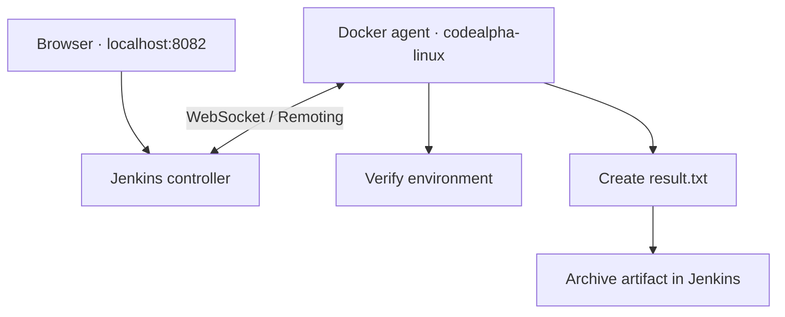

# Jenkins Remoting
### CodeAlpha DevOps Internship · Distributed Pipeline Execution


A Jenkins controller delegates a two-stage pipeline to a separate Docker agent through a WebSocket connection. The pipeline verifies the agent environment, creates a text artifact, and archives it with a fingerprint.

[Build evidence](#build-evidence) · [Architecture](#architecture) · [Setup](#setup) · [Skills demonstrated](#skills-demonstrated)

## Build evidence

The recorded build ran on **codealpha-agent** and finished with **SUCCESS**.


## What this project demonstrates

- A controller and build agent running in separate containers.
- Agent authentication and Jenkins Remoting over WebSocket.
- Label-based pipeline scheduling.
- Shell commands executed on the agent.
- Artifact archiving and fingerprinting.
- A pipeline stored in source control as a `Jenkinsfile`.

## Architecture



Both containers use the `codealpha-jenkins` Docker network. The agent connects internally to `http://codealpha-jenkins:8080/`; the browser uses `http://localhost:8082/`.

## Tech stack

| Technology | Role |
|---|---|
| Jenkins LTS | Controller, job configuration, and pipeline scheduling |
| Jenkins Remoting / WebSocket | Controller–agent communication |
| Docker / Docker Desktop | Separate controller and agent containers |
| Groovy | Declarative Pipeline in `Jenkinsfile` |
| Shell commands | Agent hostname, Java verification, and artifact creation |
| Java 21 | Jenkins/agent runtime, verified by the pipeline |
| PowerShell | Container setup commands on Windows |
| Git & GitHub | Pipeline source, documentation, and evidence |

Java is the runtime in this project; the repository's pipeline source is Groovy.

## Setup

### Requirements

- Docker Desktop with Linux containers running, or Docker Engine.
- Git and a browser.
- Internet access to download container images and Jenkins plugins.

The commands below use **PowerShell**. The image tags `lts-jdk21` and `jdk21` can receive updates; the screenshot records the versions used in the completed demo.

### 1. Clone the repository

```powershell
git clone https://github.com/dayanganganath/CodeAlpha_JenkinsRemoting.git
cd CodeAlpha_JenkinsRemoting
```

### 2. Start the controller

Run these commands for a new setup:

```powershell
docker network create codealpha-jenkins
docker volume create codealpha-jenkins-home
docker run -d --name codealpha-jenkins --network codealpha-jenkins -p 127.0.0.1:8082:8080 -v codealpha-jenkins-home:/var/jenkins_home jenkins/jenkins:lts-jdk21
```

Open **http://localhost:8082/**. Retrieve the initial unlock password locally:

```powershell
docker exec codealpha-jenkins cat /var/jenkins_home/secrets/initialAdminPassword
```

Complete the setup wizard, install suggested plugins, create an administrator account, and set the Jenkins URL to `http://localhost:8082/`. Keep passwords and agent secrets out of commits and public screenshots.

### 3. Configure the agent in Jenkins

Go to **Manage Jenkins → Nodes → New Node**, and create a **Permanent Agent**:

| Setting | Value |
|---|---|
| Name | `codealpha-agent` |
| Number of executors | `1` |
| Remote root directory | `/home/jenkins/agent` |
| Labels | `codealpha-linux` |
| Usage | Only build jobs with label expressions matching this node |
| Launch method | Launch agent by connecting it to the controller |
| Availability | Keep this agent online as much as possible |

Save the node. On its connection page, copy only the value following `-secret`. This is the agent secret, not the administrator password.

### 4. Connect the Docker agent

Run the first command, paste **only the agent secret** at the prompt, and press Enter. Then run the Docker command at the next PowerShell prompt.

```powershell
$agentSecret = Read-Host "Paste Jenkins agent secret"
docker run -d --name codealpha-agent --network codealpha-jenkins --init jenkins/inbound-agent:jdk21 -url http://codealpha-jenkins:8080/ -secret "$agentSecret" -name codealpha-agent -webSocket -workDir /home/jenkins/agent
Remove-Variable agentSecret
```

Refresh the Nodes page to confirm **Agent is connected**. Check connection logs with:

```powershell
docker logs --tail 30 codealpha-agent
```

This setup uses WebSocket through the controller's HTTP port and does not publish a separate inbound-agent TCP port.

### 5. Create and run the pipeline

1. Create a **Pipeline** job named `CodeAlpha-Agent-Demo`.
2. Select **Pipeline script**.
3. Paste the contents of [Jenkinsfile](Jenkinsfile) into the Script field.
4. Keep **Use Groovy Sandbox** enabled.
5. Select **Save → Build Now**.
6. Open the build's **Console Output**.

## Pipeline stages

| Stage | Work performed |
|---|---|
| Verify Agent | Prints `NODE_NAME`, runs `hostname`, and checks `java -version` |
| Create Artifact | Writes `result.txt`, archives it, and records its fingerprint |

Expected indicators in the console:

```text
Running on agent: codealpha-agent
Archiving artifacts
Recording fingerprints
Finished: SUCCESS
```

The archived `result.txt` contains:

```text
CodeAlpha Jenkins Remoting demo completed.
```

## Restart an existing setup

```powershell
docker start codealpha-jenkins
docker start codealpha-agent
```

Wait for the controller to finish starting and the agent to reconnect. Use these commands to stop the demo:

```powershell
docker stop codealpha-agent
docker stop codealpha-jenkins
```

The named controller volume preserves Jenkins configuration and build data across container restarts. Use the start commands for existing containers instead of repeating `docker run`.

## Repository guide

| Path | Purpose |
|---|---|
| `Jenkinsfile` | Declarative Pipeline targeting `codealpha-linux` |
| `screenshots/pipeline-success.png` | Agent execution and successful build evidence |
| `README.md` | Architecture, setup, and verification instructions |

## Skills demonstrated

- Jenkins controller–agent architecture and distributed execution.
- Docker networking and persistent controller storage.
- Agent configuration, authentication, labels, and executors.
- WebSocket-based Jenkins Remoting.
- Declarative Pipeline syntax and environment variables.
- Shell execution on a Linux agent.
- Artifact archiving, fingerprinting, and console-log verification.
- Documenting and versioning a working DevOps demo.

## Project scope

This is a local distributed-execution demo using two containers on one Docker host. The job currently uses an inline copy of the committed Jenkinsfile; automatic SCM triggers and application deployment are outside this demo.

---

Built by [Dayan Ganganath](https://github.com/dayanganganath) as part of the CodeAlpha DevOps Internship.

**More CodeAlpha projects:** [Docker Web Server](https://github.com/dayanganganath/CodeAlpha_DockerWebServer) · [Gradle Java App](https://github.com/dayanganganath/CodeAlpha_GradleJava)
