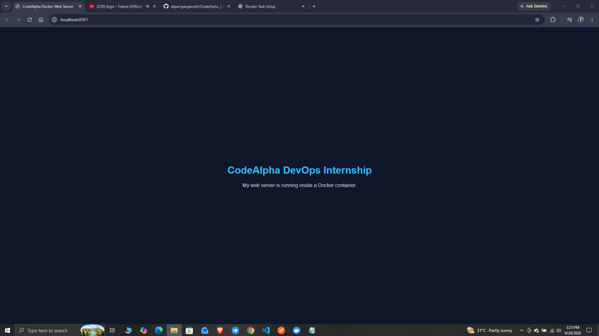
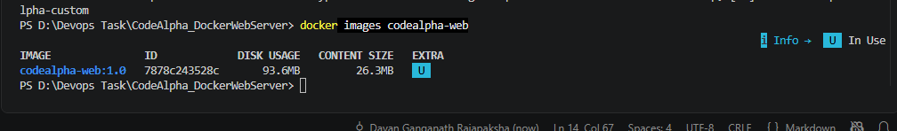

# Docker Web Server
### CodeAlpha DevOps Internship · Containerization


A static web page packaged in a custom Docker image and served by Nginx. This project demonstrates the complete local workflow: write a Dockerfile, build an image, start a container, publish a port, and inspect the running service.

[Preview](#preview) · [Tech stack](#tech-stack) · [Quick start](#quick-start) · [Skills demonstrated](#skills-demonstrated)

## Preview



## What this project does

- Serves a custom HTML page with embedded CSS.
- Uses the lightweight `nginx:alpine` base image.
- Copies the page into Nginx's default document directory at build time.
- Publishes the container's HTTP port to a local browser.
- Demonstrates container status checks, logs, stop, and start commands.

## Tech stack

| Technology | Role |
|---|---|
| HTML5 | Web page structure and content |
| CSS3 | Page layout, typography, and colors |
| Dockerfile | Image build instructions |
| Docker / Docker Desktop | Image builds and container lifecycle |
| Nginx on Alpine Linux | Static web server inside the container |
| PowerShell | Local build and management commands |
| Git & GitHub | Source control, documentation, and evidence |

## How it works

`Dockerfile` builds the image from `nginx:alpine`. The `COPY` instruction installs `index.html` at `/usr/share/nginx/html/index.html`. Docker maps host port **8081** to container port **80**.

```dockerfile
FROM nginx:alpine
COPY index.html /usr/share/nginx/html/index.html
EXPOSE 80
```

`EXPOSE 80` documents the container port; the `-p` option below publishes it to the host.

## Quick start

### Requirements

- Docker Desktop with the Linux container engine running, or Docker Engine.
- Git and a web browser.
- Internet access for the initial base-image download.

### 1. Clone the repository

```powershell
git clone https://github.com/dayanganganath/CodeAlpha_DockerWebServer.git
cd CodeAlpha_DockerWebServer
```

### 2. Build the image

```powershell
docker build -t codealpha-web:1.0 .
```

### 3. Start the web server

```powershell
docker run -d --name codealpha-custom -p 127.0.0.1:8081:80 codealpha-web:1.0
```

Open **http://localhost:8081**. This command binds the published port to the local machine.

If a container named `codealpha-custom` already exists, start it with `docker start codealpha-custom` instead of creating it again.

### 4. Inspect and manage

```powershell
docker ps --filter "name=codealpha-custom"
docker images codealpha-web
docker logs codealpha-custom
docker stop codealpha-custom
docker start codealpha-custom
```

After changing `index.html`, rebuild the image and replace the existing container to serve the new content.

## Verification

The recorded demo shows the custom page at `localhost:8081`, the running `codealpha-custom` container, and the `codealpha-web:1.0` image.



## Repository guide

| Path | Purpose |
|---|---|
| `Dockerfile` | Nginx image definition |
| `index.html` | Web page and embedded styles |
| `screenshots/web-page.png` | Browser verification |
| `screenshots/docker-terminal.png` | Image and container verification |

## Skills demonstrated

- Containerization of a static website.
- Docker image layers, base images, build context, and file copying.
- Host-to-container port mapping.
- Image tags and named containers.
- Container lifecycle management and log inspection.
- Documenting a reproducible local deployment.
- Git commits, GitHub repositories, and project evidence.

## Project scope

This is a local learning demo for static HTTP hosting. The repository contains the Dockerfile and page; it does not configure a custom domain, HTTPS, or an automated deployment pipeline.

---

Built by [Dayan Ganganath](https://github.com/dayanganganath) as part of the CodeAlpha DevOps Internship.

**More CodeAlpha projects:** [Gradle Java App](https://github.com/dayanganganath/CodeAlpha_GradleJava) · [Jenkins Remoting](https://github.com/dayanganganath/CodeAlpha_JenkinsRemoting)
